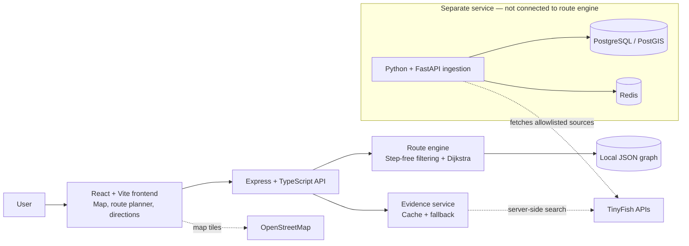

<div align="center">


<sub><i>Illustrative hero artwork — not a live application screenshot or a verified site map.</i></sub>

# AccessRoute AI

### Accessibility is a constraint, not a preference.

**Evidence-aware, step-free navigation for places where the shortest route may not be accessible.**

[](#limitations)
[](frontend/)
[](backend/)
[](LICENSE)

[Architecture](#architecture) · [Run locally](#run-locally) · [Features](#features) · [Limitations](#limitations)

</div>

---

## Why AccessRoute?

A route can be short and still be unusable. For someone who needs step-free access, a staircase is not a small inconvenience—it can make the route impossible.

AccessRoute AI puts accessibility first: it excludes known inaccessible edges when step-free mode is enabled and makes uncertainty visible instead of presenting every path as equally reliable.

## Features

- **Step-free routing:** known `not_step_free` edges are removed before Dijkstra pathfinding; there is no fallback through stairs.
- **Evidence-aware routes:** each path segment is labelled as verified, reported, unknown, or inaccessible, with warnings where needed.
- **Interactive map:** Leaflet and OpenStreetMap tiles display routes and their evidence status.
- **Directions that work for people:** turn-by-turn text, browser-based audio directions, and copy/print support.
- **Cited web context:** TinyFish Search supplies supplementary destination evidence. It does not choose or override a route.
- **Resilient local routing:** route calculation uses the bundled graph and does not depend on the web-evidence service being available.

**Implementation status:** the main React + Express route-planning experience is wired end to end. The Python ingestion and barrier-report service exists separately and is **not connected to the app's route engine**. Accessible-entrance discovery and a surveyed, production-grade graph are planned, not built.

## Architecture



### How a route is calculated

1. The user chooses a start point, destination, and step-free preference.
2. The API validates the request and loads the local graph.
3. In step-free mode, edges marked `not_step_free` are excluded; Dijkstra finds the shortest path through the remaining graph.
4. The app shows the route, directions, and warnings for reported or unassessed segments.
5. Destination web evidence is shown separately, with provider and cache/fallback information. It never changes the route.

### Accessibility evidence states

| Status | Meaning in the prototype |
|---|---|
| `verified_step_free` | Marked as verified in the dataset; not a substitute for a professional on-site audit. |
| `reported_step_free` | Reported as step-free, but not independently verified. |
| `unknown` | Not assessed; shown with a warning. |
| `not_step_free` | Known barrier; excluded when step-free mode is on. |

## Technology

| Layer | Stack |
|---|---|
| Frontend | React 19, TypeScript, Vite 6, Leaflet |
| API and routing | Node.js 22+, Express 5, TypeScript, Dijkstra + binary min-heap |
| Map and evidence | OpenStreetMap tiles, TinyFish Search / Fetch APIs |
| Standalone ingestion | Python 3.13, FastAPI, Pydantic, PostgreSQL/PostGIS, Redis |
| Quality and delivery | Vitest, pytest, Docker Compose, GitHub Actions |

## Run locally

**Prerequisites:** Node.js 22+, npm, and a TinyFish API key. The backend currently requires `TINYFISH_API_KEY` at startup, even though route calculation itself is local.

```bash
# Install frontend and backend dependencies
npm run install:all

# Create backend configuration, then add your key
cp backend/.env.example backend/.env
```

Start the backend and frontend in separate terminals:

```bash
npm run dev:backend
```

```bash
npm run dev:frontend
```

Open the local URL printed by Vite (normally `http://localhost:5173`). The backend normally runs at `http://localhost:3001`.

**Docker option:** create a root `.env` from `.env.example`, set `TINYFISH_API_KEY`, then run:

```bash
docker compose up --build
```

The Docker frontend is served at `http://localhost:8080`.

## Useful commands and API

| Command | Purpose |
|---|---|
| `npm test` | Backend unit tests (Vitest) |
| `npm run typecheck` | Type-check backend and frontend |
| `npm run build` | Build the applications |
| `cd services/ingestion && python -m pytest` | Run ingestion tests |

Core backend endpoints:

| Method | Endpoint | Purpose |
|---|---|---|
| `GET` | `/api/health` | Service health |
| `GET` | `/api/locations` | Available locations |
| `POST` | `/api/route` | Calculate a route |
| `GET` | `/api/evidence/:locationId` | Retrieve destination evidence |

See [`docs/api/API_CONTRACTS.md`](docs/api/API_CONTRACTS.md) and [`docs/api/BACKEND_API_REFERENCE.md`](docs/api/BACKEND_API_REFERENCE.md) for fuller contracts.

## Project structure

```text
frontend/             React interface, map, route results and API client
backend/              Express API, route engine, graph data and tests
services/ingestion/   Standalone FastAPI ingestion and report service
shared/types.ts       Shared TypeScript types
docs/                 Architecture, product and API documentation
.github/workflows/    CI workflow
docker-compose.yml    Frontend + backend containers
```

## Limitations

- The bundled demo graph contains **16 nodes and 21 edges** for a subset of the Delhi High Court complex. Coordinates and distances are approximate and have not been validated through an on-site accessibility survey.
- Only a portion of the graph is marked `verified_step_free`; that label is not professional certification. Unknown segments may still appear in a route, but are flagged.
- The app does not yet integrate live lift/outage data or barrier reports into routing. The ingestion service is standalone and currently targets a separate Delhi Metro lift scenario.
- TinyFish evidence results are supplementary search material; the confidence label is a heuristic based on result count, not a measure of source reliability.
- Automated frontend/end-to-end tests and a manual accessibility audit are not recorded. Test files exist, but their passing results are not stored in the repository.
- A hosted demo URL and application screenshots are not currently provided.

**Safety note:** this is a hackathon prototype, not a source of verified real-world navigation guidance. Independently check paths and entrances on site before relying on them for accessibility-critical travel.

### Roadmap

1. Survey and verify routes, entrances, slopes, widths, and stable graph geometry.
2. Connect the ingestion pipeline and reviewed barrier reports to route availability.
3. Add accessible-entrance discovery and user-specific mobility constraints.
4. Add end-to-end tests, complete a manual accessibility audit, and harden public-facing endpoints before deployment.

## Contributing and license

Contributions are welcome. See [`CONTRIBUTING.md`](CONTRIBUTING.md) for project conventions; never guess accessibility status, expose API secrets, or let unverified evidence silently change a route.

Released under the [MIT License](LICENSE).

---

<div align="center"><sub>Built so nobody is routed through a staircase and told it is the best way.</sub></div>
