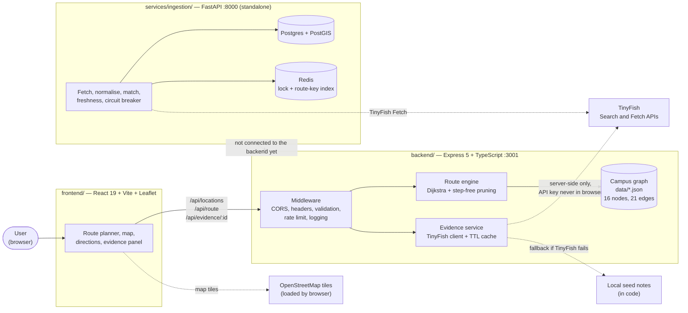
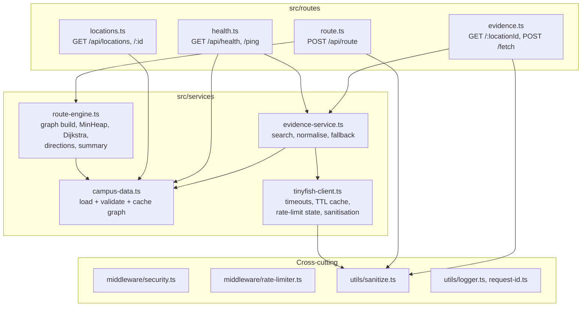
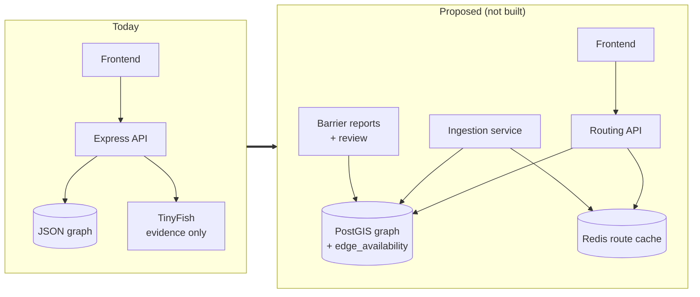
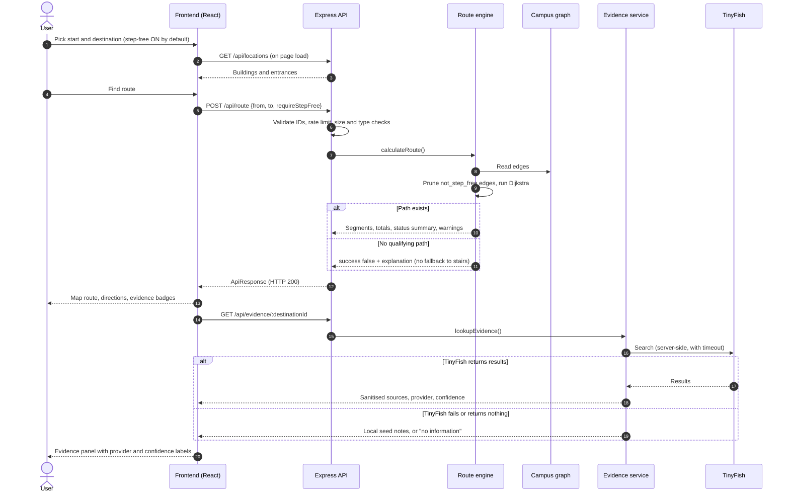
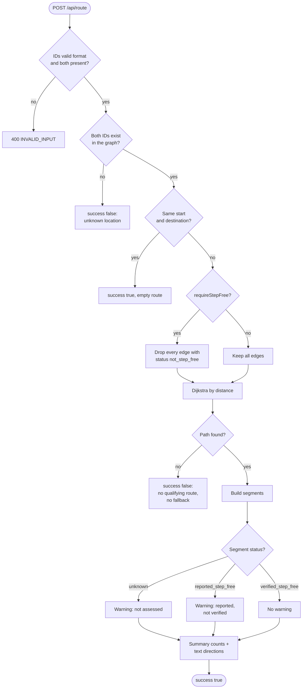
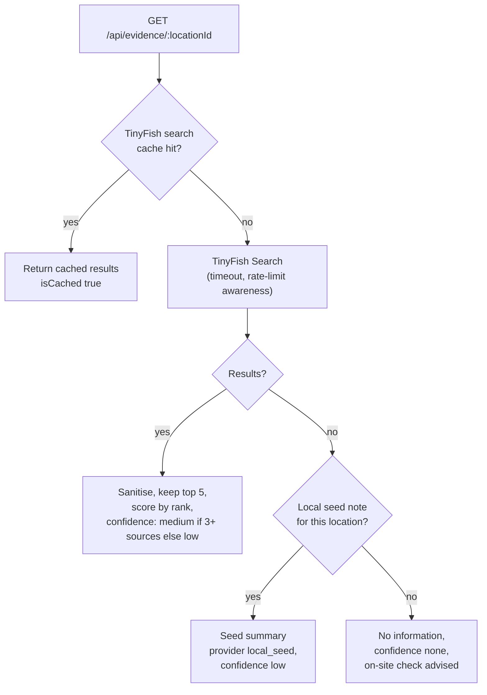
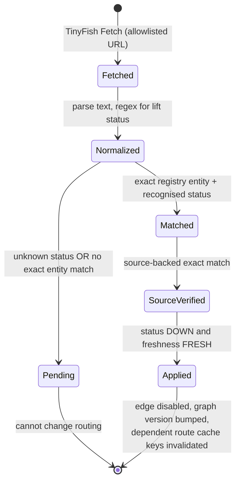

<div align="center">


<sub><i>Illustrative render used as the app's hero art. It is not a screenshot and does not depict the Delhi High Court.</i></sub>

# AccessRoute AI

### Accessibility is a constraint, not a preference.

**Evidence-first, step-free navigation. Piloted on the Delhi High Court complex, Sher Shah Road, New Delhi.**

[](LICENSE)
[](#installation-and-local-setup)
[](frontend/)
[](backend/)
[](shared/types.ts)
[-3776AB?logo=python&logoColor=white)](services/ingestion/)


[Live demo: *pending*](#screenshots-and-demo) · [Architecture](#system-architecture) · [Quick start](#installation-and-local-setup) · [For judges](#for-judges-at-a-glance) · [Limitations](#current-limitations-and-roadmap)

</div>

---

## Table of Contents

1. [For Judges at a Glance](#for-judges-at-a-glance)
2. [The Problem](#the-problem)
3. [Our Solution](#our-solution)
4. [Feature Showcase](#feature-showcase)
5. [System Architecture](#system-architecture)
6. [End-to-End Workflow](#end-to-end-workflow)
7. [Technical Stack](#technical-stack)
8. [Repository Structure](#repository-structure)
9. [Core Algorithms and Data Flow](#core-algorithms-and-data-flow)
10. [Installation and Local Setup](#installation-and-local-setup)
11. [Configuration and API Documentation](#configuration-and-api-documentation)
12. [Screenshots and Demo](#screenshots-and-demo)
13. [Testing and Validation](#testing-and-validation)
14. [Security, Privacy, and Accessibility](#security-privacy-and-accessibility)
15. [Current Limitations and Roadmap](#current-limitations-and-roadmap)
16. [Hackathon Innovation](#hackathon-innovation)
17. [Impact and Future Scope](#impact-and-future-scope)
18. [Contributing, License, Acknowledgements, and Contact](#contributing-license-acknowledgements-and-contact)

**Status legend used throughout:** ✅ implemented and wired end to end · 🧩 implemented but standalone (not connected to the app) · 📝 planned, not built

---

## For Judges at a Glance

| Question | Short answer |
|---|---|
| **What problem?** | Standard map routing optimises distance. For a wheelchair user, one staircase on the "shortest" path makes the whole route unusable. |
| **Who benefits?** | Wheelchair users, people with mobility difficulties, and others who need step-free access: for example litigants, advocates, senior citizens and visitors at a court complex. |
| **What is different?** | Stairs are **removed from the graph** before the search runs, instead of being penalised. Every path segment carries one of four evidence levels, and uncertainty is shown rather than hidden. If no step-free route exists, the system says so; it never falls back to stairs. |
| **Where is AI used?** | [TinyFish](https://www.tinyfish.ai/) web Search and Fetch APIs supply cited, labelled web evidence next to each route. **Routing itself is a deterministic algorithm, not a model**, by design ([ADR-002](docs/architecture/DECISIONS.md)). |
| **What can I try today?** | Run the app locally ([Quick start](#installation-and-local-setup)). Four preset scenarios, a route planner, a map, audio directions, and an evidence panel. A hosted demo link is **pending**. |
| **What is the evidence?** | 43 backend unit tests are present in the repo (routing constraints, input sanitisation, data integrity), and a CI workflow is defined. Results of runs are not recorded in the repo. See [Testing and Validation](#testing-and-validation). |
| **What is *not* done?** | Campus data is a small, **unsurveyed** demo graph (16 nodes, 21 edges). The ingestion service and crowd-report workflow are not connected to the app. No accessibility audit of the UI has been recorded. See [Limitations](#current-limitations-and-roadmap). |

> ⚠️ **Not for real navigation decisions.** The bundled campus data is approximate and was assembled for a hackathon demonstration. It must be independently verified on site before anyone who depends on step-free access relies on it. See [`backend/data/accessibility-sources.json`](backend/data/accessibility-sources.json).

---

## The Problem

Mainstream navigation answers one question: *what is the shortest path?* For people who cannot use stairs, that is the wrong question.

- **Shortest is often impassable.** A 25 m route through a stepped entrance beats a 60 m ramped one on distance, so a distance-minimising router prefers it.
- **Penalty-based routing still fails.** Many routers add a cost to stairs (for example "treat stairs as 5x longer"). If the accessible alternative is long, missing, or unverified, the stairs can still win. For a wheelchair user that is not a worse route; it is no route.
- **Accessibility data is uneven.** Some paths are surveyed, some are only reported by visitors, and many have never been assessed. A router that treats all of these as equally trustworthy is making a hidden claim.
- **Heritage and civic buildings are hard cases.** A complex such as the Delhi High Court mixes an original stepped building with modern ramped blocks, and visitors arrive under time pressure for hearings.

## Our Solution

AccessRoute AI treats step-free access as a **hard requirement of the search**, and treats **certainty as part of the answer**.

> **Problem → Insight → Solution**
> *Problem:* shortest-path routing can send people through barriers.
> *Insight:* accessibility must be a constraint (what is allowed), not a cost (what is discouraged), and the system must be honest about how sure it is.
> *Solution:* a deterministic graph router that prunes inaccessible edges, labels every segment by evidence level, and attaches sourced web evidence without letting that evidence override the graph.

Three design commitments, enforced in code and documented in [`docs/architecture/DECISIONS.md`](docs/architecture/DECISIONS.md):

1. **Zero silent fallback.** With step-free mode on, edges marked `not_step_free` are excluded before Dijkstra runs. No path, no stairs.
2. **Truth in uncertainty.** `unknown` and `reported_step_free` segments are still offered, but flagged in warnings, directions, and on the map.
3. **Evidence is a sidecar.** Web evidence is labelled with its provider, cache state and confidence, and never changes a route. A web page saying "accessible entrance" does not prove the connecting path is step-free.

---

## Feature Showcase

| | Feature | Status | Details |
|---|---|---|---|
| 🚫 | **Hard step-free exclusion** | ✅ | `requireStepFree` removes `not_step_free` edges from the graph before search. Defaults to on in the UI. |
| 🧭 | **Deterministic route engine** | ✅ | Dijkstra with a binary min-heap over a local JSON graph. Works without any external service. |
| 🏷️ | **Four-level evidence model** | ✅ | `verified_step_free`, `reported_step_free`, `unknown`, `not_step_free`, with per-route summary counts and per-segment warnings. |
| ⛔ | **Honest "no route" result** | ✅ | Returns `success: false` with an explanation and a facilitation-desk prompt in the UI, never a stair route. |
| 🔎 | **Cited web evidence** | ✅ | TinyFish Search results for the destination, shown with provider, cached/live state and a confidence label. Falls back to local seed notes when TinyFish is unreachable. |
| 🗺️ | **Interactive map** | ✅ | Leaflet + OpenStreetMap tiles; segments coloured by evidence level (unknown segments dashed); offline-tiles banner. |
| 🔊 | **Audio directions** | ✅ | Browser Web Speech API reads steps aloud, with the active step highlighted. |
| 📋 | **Copy and print plan** | ✅ | One-click copy of text directions; print stylesheet included. |
| ⚡ | **Quick scenarios** | ✅ | Four preset routes for fast demos. |
| ♿ | **Accessible UI semantics** | ✅ | Skip link, labelled form controls, `aria-live` regions, `role="alert"` errors, visible focus styles, reduced-motion media query. Manual testing is **not yet recorded** ([details](#security-privacy-and-accessibility)). |
| 🛡️ | **API hardening basics** | ✅ | ID validation, body size limit, content-type check, security headers, per-IP rate limit, key kept server-side. |
| 🐳 | **Docker and CI** | ✅ | `docker-compose.yml` for frontend + backend; GitHub Actions for backend, frontend, and ingestion. |
| 📡 | **Alert ingestion pipeline** | 🧩 | Python/FastAPI service that fetches an allowlisted source via TinyFish, normalises lift-status alerts, applies strict entity matching, and invalidates cached routes. Currently targets a **Delhi Metro lift scenario**, not the court campus. |
| 👥 | **Barrier reports with confirmation** | 🧩 | A report stays `PENDING` until two distinct reporter IDs confirm it. It cannot change an edge by itself. Not exposed in the UI. |
| 🚪 | **Accessible-entrance discovery** | 📝 | Entrances are selectable nodes with free-text notes. There is no ranking or discovery logic yet. |
| 🧱 | **Verified geometry and PostGIS graph** | 📝 | Planned; see [roadmap](#current-limitations-and-roadmap). |

---

## System Architecture

### High-level architecture (current)



### Component-level view (backend)



### Component responsibilities and failure handling

| Component | Responsibility | If it fails |
|---|---|---|
| **Campus data loader** | Parses `campus-nodes.json` and `campus-edges.json`; validates types, uniqueness, referential integrity, positive distances; caches in memory. | The server **refuses to start** with a descriptive error. |
| **Route engine** | Builds the adjacency list (pruning stairs when required), runs Dijkstra, produces segments, warnings, directions, and a status summary. | Unknown IDs and no-path cases return a structured `success: false` result (HTTP 200). Unexpected exceptions return HTTP 500 with `ROUTE_CALCULATION_ERROR`. |
| **Evidence service + TinyFish client** | Queries TinyFish Search for the destination, sanitises and normalises up to five results, caches them (default 5 min). | Falls back to local seed notes, then to an explicit "no information" result. The response's `provider`, `isCached` and `confidence` fields say which happened. |
| **Health endpoint** | Reports route-engine, campus-data and TinyFish status. | Returns `degraded` if TinyFish is down; `503 unhealthy` if the graph cannot load. |
| **Frontend API client** | Calls `/api/*` through the Vite proxy (or `VITE_API_BASE_URL`), with a 15 s timeout and a `localhost:3001` fallback in dev. | Shows a network-error state with retry; evidence failure just hides the evidence panel. |

### Current vs proposed architecture

| Concern | Current (✅ / 🧩) | Proposed (📝) |
|---|---|---|
| Graph storage | JSON files loaded into memory | PostGIS/pgRouting graph with stable edge IDs and surveyed geometry |
| Live conditions | None in the app. Ingestion service exists separately. | Ingestion writes `edge_availability` overlays that the route engine reads; Redis route cache is invalidated per affected edge |
| User reports | Standalone endpoint, in-memory or Postgres store | Reports surfaced in the UI, reviewed, then applied under a confirmation policy |
| Rate limiting | In-memory, per process | Shared store (the code comment itself suggests Redis) |



---

## End-to-End Workflow

### Principal user journey



### Decision flow inside a route request



### How obstacles and reports affect the experience

- **Known barriers** (`not_step_free` edges such as the three stair edges in the dataset) are excluded in step-free mode.
- **Unassessed or merely reported segments** stay routable but are flagged, so the user sees where the system is unsure.
- **Live outages and crowd reports** are modelled in the standalone ingestion service (see [below](#ingestion-and-barrier-report-pipeline-standalone)) but do **not** yet affect routes in the app.

---

## Technical Stack

| Layer | Technology | Why it is used |
|---|---|---|
| **Frontend** | React 19, TypeScript, Vite 6 | Small, typed SPA with a fast dev loop and a dev proxy to the API. |
| **Map** | Leaflet 1.9 + OpenStreetMap tiles | Lightweight and free; the route is drawn from node coordinates returned by the API. (An earlier MapLibre prototype is kept in [`archive/`](archive/).) |
| **Browser APIs** | Web Speech API, Clipboard API, print CSS | Audio directions, copy plan, printable sheet, with no extra dependencies. |
| **Backend** | Node.js 22, Express 5, TypeScript, `tsx` (dev) | Simple JSON API with strict typing shared in spirit with the frontend. |
| **Routing** | Custom Dijkstra + binary min-heap | Deterministic, explainable, offline-capable; makes hard exclusion trivial to guarantee and test. |
| **Data** | JSON graph (`backend/data/`) validated at startup | A reviewable, diff-able seed dataset; fails fast on bad data. |
| **AI / web evidence** | [TinyFish](https://www.tinyfish.ai/) Search and Fetch APIs | Retrieves cited web material server-side, so the key never reaches the browser. |
| **Ingestion service** | Python 3.13, FastAPI, httpx, Pydantic 2, psycopg 3, redis-py | Typed models for alerts, retry with circuit breaker, Postgres persistence, Redis lock and cache-index. |
| **Datastores (ingestion only)** | PostGIS 16 (`postgis/postgis:16-3.4`), Redis 7 | Durable alert/edge state and a distributed single-flight lock. |
| **Testing** | Vitest (backend), pytest + pytest-asyncio (ingestion) | Unit tests for routing, sanitisation, data integrity, and ingestion rules. |
| **Delivery** | Docker, Docker Compose, nginx, GitHub Actions | One-command run for the app; CI for all three workspaces. |

---

## Repository Structure

```text
AccessRoute-AI/
├── frontend/                     React 19 + TypeScript + Vite + Leaflet UI
│   ├── src/
│   │   ├── App.tsx               Page layout, hero, presets, state machine for route requests
│   │   ├── components/
│   │   │   ├── RouteSelector.tsx   Start / destination / step-free toggle, validation
│   │   │   └── RouteResult.tsx     Directions, status badges, audio, copy/print, evidence panel
│   │   ├── features/map/MapView.tsx  Leaflet map, evidence-coloured route segments
│   │   ├── services/apiClient.ts   Typed client for /api/*
│   │   ├── types/index.ts          Frontend copy of the API types
│   │   ├── styles/globals.css      Design system, responsive rules, reduced-motion, print
│   │   └── assets/accessroute-hero-3d.png
│   ├── Dockerfile, nginx.conf    Static build served by nginx; proxies /api to backend
│   └── .env.example              Optional VITE_API_BASE_URL
├── backend/                      Express API, routing engine, graph data, tests
│   ├── src/
│   │   ├── server.ts             App wiring, CORS, middleware order, graceful shutdown
│   │   ├── config.ts             Env loading; TINYFISH_API_KEY is required
│   │   ├── routes/               health, locations, route, evidence handlers
│   │   ├── services/
│   │   │   ├── route-engine.ts     Graph build, Dijkstra, directions, summary
│   │   │   ├── campus-data.ts      Load and validate the graph
│   │   │   ├── evidence-service.ts Evidence orchestration + local seed fallback
│   │   │   └── tinyfish-client.ts  Search/Fetch client, cache, timeouts, sanitisation
│   │   ├── middleware/           security headers, rate limiter
│   │   └── utils/                sanitize, logger, request-id
│   ├── data/
│   │   ├── campus-nodes.json     16 nodes (gates, buildings, junctions, a landmark)
│   │   ├── campus-edges.json     21 edges with status, path type, evidence note
│   │   └── accessibility-sources.json  Source list, data scope, explicit disclaimer
│   ├── test/                     route-engine, sanitize, campus-data tests (Vitest)
│   ├── Dockerfile, .env.example
├── services/ingestion/           🧩 FastAPI ingestion + barrier-report service
│   ├── app/                      main, ingestion, tinyfish, storage, models, source_registry, config
│   ├── tests/test_ingestion.py   6 pytest tests
│   └── Dockerfile, requirements.txt
├── shared/types.ts               Canonical cross-service TypeScript types
├── docs/                         Architecture, API, product, data and routing, ingestion docs
├── archive/web-maplibre-preview/ Earlier MapLibre frontend prototype (reference only)
├── .github/workflows/ci.yml      CI for backend, frontend, ingestion
├── docker-compose.yml            frontend (nginx :8080) + backend
├── docker-compose.ingestion.yml  ingestion + PostGIS + Redis
├── .env.example                  Variables read by the compose files
└── package.json                  Root helper scripts
```

---

## Core Algorithms and Data Flow

### The evidence model

Every edge in `campus-edges.json` carries an `accessibilityStatus`:

| Status | Meaning in this repo | Step-free mode | Warning shown |
|---|---|---|---|
| `verified_step_free` | Backed by cited evidence in the dataset (the seed data's own caveat applies: not a professional audit) | Included | No |
| `reported_step_free` | Reported by visitors, advocates or staff, not formally checked | Included | "reported but not independently verified" |
| `unknown` | Not assessed | Included | "NOT been assessed. Proceed with caution or seek assistance." |
| `not_step_free` | Known stairs or barrier | **Excluded from the graph** | n/a |

Each edge also records `pathType` (`sidewalk`, `corridor`, `ramp`, `elevator`, `stairs`, `outdoor_path`, `crossing`), a `sourceEvidence` note, and, where available, `lastVerified`.

### Routing: prune, then search

1. **Build adjacency list.** If `requireStepFree` is true, skip every edge with `accessibilityStatus === 'not_step_free'`. Edges are treated as undirected.
2. **Run Dijkstra** with a binary min-heap. The edge weight is `distanceMeters`; status does **not** change the weight. Accessibility is enforced by pruning, not by cost.
3. **Reconstruct segments**, tracking traversal direction for each edge, and generate an instruction per segment.
4. **Attach honesty metadata:** a per-status breakdown, flags for unknown/reported segments, and warning strings.
5. **Estimate time** as `ceil(totalDistance / 75)` minutes (75 m/min, about 4.5 km/h).

If the search finds no path in the pruned graph, the engine returns `success: false` with a message stating that this is **not** a fallback. On the bundled dataset every pair of the 12 selectable locations has a step-free path (checked with an independent re-implementation of the same graph logic); the no-route behaviour is covered by the unit tests' constructed cases and applies when data changes.

### Worked example from the bundled data

Route: **Lawyers Chambers Block I → Lawyers Chambers Block II**

| Mode | Path | Distance | Evidence along the path |
|---|---|---|---|
| Standard (`requireStepFree: false`) | Direct stairs edge | 30 m | `not_step_free` (stairs) |
| **Step-free** (`requireStepFree: true`) | Chambers I → South Walkway Junction → Chambers II | **75 m** | Two `unknown` outdoor-path segments, each flagged with a warning |

The step-free route is longer, and it is honest that both segments are unassessed. That pairing of *no stairs* with *no false certainty* is the behaviour the project is built around.

### Evidence retrieval (AI web sidecar)



Key properties:

- **Boundary:** evidence never alters routing. This is stated in code comments and ADR-002.
- **Labelling:** every response says whether it came from live search, cache, or local seed.
- **Confidence is a coarse heuristic**, based on the number of results returned, not on a judgement of source quality. Treat it as "how much was found", not "how reliable it is".
- **Sanitisation:** titles, snippets and fetched text are stripped of HTML tags, `javascript:` patterns and inline handlers, and length-limited before use.
- **Not wired:** `POST /api/evidence/fetch` (detailed fetch of one URL) exists in the API but the frontend does not call it.

### Ingestion and barrier-report pipeline (standalone)

🧩 This is a separate Python service. It is **not** connected to the Express backend, and it does **not** serve `/api/route` or `/api/places`. Its registry contains a single *candidate* source: a Delhi Metro lift scenario ("Govindpuri"), deliberately separate from the court-campus pilot.



What the code and tests establish:

- **Strict matching.** Only an exact registry entity reference can reach the graph; broad or ambiguous text stays `PENDING`.
- **Freshness.** Alerts are `FRESH` within 15 minutes by default, else `STALE`; stale data never certifies accessibility.
- **Idempotency.** Duplicate events (hash of source, status and text) are ignored.
- **Resilience.** Retries on 429/5xx with exponential backoff, a circuit breaker (3 failures, 300 s reset by default), and a "retained state" fallback when the provider is down.
- **Single-flight.** An overlap lock (Redis `SET NX` with a 120 s expiry in the persistent store) prevents concurrent runs.
- **Crowd reports.** A report starts `PENDING`; two distinct `reporter_id` values mark it `CROWD_CONFIRMED`. A single report cannot modify an edge. `reporter_id` is self-asserted, so this is a prototype of the policy, not abuse-resistant identity.

---

## Installation and Local Setup

### Prerequisites

- **Node.js 22+** and npm (the code and CI use Node 22)
- A **TinyFish API key**. The backend **refuses to start without `TINYFISH_API_KEY`**, even though routing itself does not need it.
- *Optional:* Docker with Compose; Python 3.13 for the ingestion service

### Option A: run locally (two terminals)

```bash
# 1. Install both apps
npm run install:all

# 2. Configure the backend (the key stays server-side)
cp backend/.env.example backend/.env
#    then edit backend/.env and set TINYFISH_API_KEY

# 3a. Terminal 1: backend  -> http://localhost:3001
npm run dev:backend

# 3b. Terminal 2: frontend -> http://localhost:5173  (proxies /api to :3001)
npm run dev:frontend
```

Verify the backend:

```bash
curl http://localhost:3001/api/health/ping
curl http://localhost:3001/api/locations
curl -X POST http://localhost:3001/api/route \
  -H "Content-Type: application/json" \
  -d '{"from":"lawyers-chambers-1","to":"lawyers-chambers-2","requireStepFree":true}'
```

### Option B: Docker (frontend + backend)

```bash
cp .env.example .env          # set TINYFISH_API_KEY
docker compose up --build     # app at http://localhost:8080 (nginx proxies /api)
```

### Option C: ingestion stack (optional, standalone)

```bash
cp .env.example .env          # set TINYFISH_API_KEY and INGESTION_ADMIN_TOKEN
docker compose -f docker-compose.ingestion.yml up --build   # API at http://localhost:8000
```

### Useful commands

| Command | Purpose |
|---|---|
| `npm run install:all` | Install backend and frontend dependencies |
| `npm run dev:backend` / `npm run dev:frontend` | Start each dev server |
| `npm test` | Backend unit tests (Vitest) |
| `npm run typecheck` | Type-check backend and frontend |
| `npm run build` | Production build of both apps |
| `npm run docker:up` | Build and run frontend + backend in Docker |
| `npm run docker:ingestion` | Run the ingestion stack |
| `cd services/ingestion && pip install -r requirements.txt && python -m pytest` | Ingestion tests |

---

## Configuration and API Documentation

### Environment variables

**Backend** ([`backend/.env.example`](backend/.env.example))

| Variable | Default | Purpose |
|---|---|---|
| `TINYFISH_API_KEY` | none, **required** | Server-side TinyFish credential. Never sent to the browser. |
| `PORT` | `3001` | API port |
| `NODE_ENV` | `development` | In `production`, error details are hidden |
| `CORS_ORIGIN` | `http://localhost:5173` | Allowed origin (localhost origins are also accepted) |
| `RATE_LIMIT_WINDOW_MS` | `60000` | Rate-limit window |
| `RATE_LIMIT_MAX_REQUESTS` | `100` | Requests per IP per window |
| `TINYFISH_SEARCH_TIMEOUT_MS` | `8000` | Search timeout |
| `TINYFISH_FETCH_TIMEOUT_MS` | `12000` | Fetch timeout |
| `TINYFISH_MAX_RETRIES` | `2` | Loaded into config, but the Node TinyFish client does not currently retry |
| `TINYFISH_CACHE_TTL_MS` | `300000` | In-memory evidence cache lifetime |

**Frontend** ([`frontend/.env.example`](frontend/.env.example)): `VITE_API_BASE_URL` (optional; defaults to the Vite `/api` proxy).

**Root `.env`** ([`.env.example`](.env.example), read by Compose): `TINYFISH_API_KEY`, plus for ingestion `INGESTION_ADMIN_TOKEN` (set a real value; `change-me` is only a placeholder), `DATABASE_URL`, `REDIS_URL`, `INGESTION_SCHEDULER_ENABLED`, `PERSISTENT_STORE_ENABLED`.

**Ingestion tuning** (read by [`services/ingestion/app/config.py`](services/ingestion/app/config.py), not listed in `.env.example`): `ALERT_FRESHNESS_MINUTES` (15), `ALERT_RETENTION_HOURS` (4), `TINYFISH_FAILURE_THRESHOLD` (3), `TINYFISH_CIRCUIT_RESET_SECONDS` (300).

### Backend API

All responses use one envelope:

```jsonc
{ "success": true, "data": { /* payload */ }, "meta": { "timestamp": "...", "requestId": "...", "duration": 3 } }
// errors: { "success": false, "error": { "code": "INVALID_INPUT", "message": "...", "details": "..." }, "meta": { ... } }
```

| Method | Path | Purpose |
|---|---|---|
| `GET` | `/api/health` | Engine, data and TinyFish status (`healthy` / `degraded` / `unhealthy`) |
| `GET` | `/api/health/ping` | Liveness probe |
| `GET` | `/api/locations` | Selectable locations (buildings and entrances) |
| `GET` | `/api/locations/:id` | One location |
| `POST` | `/api/route` | Compute a route |
| `GET` | `/api/evidence/:locationId` | Web evidence for a location |
| `POST` | `/api/evidence/fetch` | Fetch one URL via TinyFish (`{ "url": "...", "locationName": "..." }`); not used by the UI |

**`POST /api/route`**: request

```json
{ "from": "main-gate", "to": "c-block", "requireStepFree": true }
```

Response (abridged; values computed from the bundled data):

```jsonc
{
  "success": true,
  "data": {
    "success": true,
    "route": [
      { "from": { "id": "main-gate", "...": "..." },
        "to":   { "id": "junction-central", "...": "..." },
        "edge": { "id": "e-maingate-junction-central", "distanceMeters": 100,
                  "accessibilityStatus": "verified_step_free", "pathType": "sidewalk" },
        "instruction": "Walk toward Central Courtyard Junction" }
      // ... 2 more segments (to North Corridor Junction, then up the ramp to C Block)
    ],
    "totalDistanceMeters": 215,
    "estimatedWalkingMinutes": 3,
    "accessibilitySummary": {
      "allVerifiedStepFree": true, "hasUnknownSegments": false, "hasReportedOnlySegments": false,
      "unknownSegmentCount": 0, "reportedOnlySegmentCount": 0,
      "statusBreakdown": { "verified_step_free": 3, "reported_step_free": 0, "not_step_free": 0, "unknown": 0 }
    },
    "textDirections": ["Start at Delhi High Court Main Gate (Gate No. 1).", "1. Walk 0.10km along the sidewalk toward ...", "..."],
    "warnings": [],
    "computedAt": "2026-10-25T00:00:00.000Z"
  },
  "meta": { "timestamp": "...", "requestId": "...", "duration": 1 }
}
```

Behaviour notes: a "no qualifying route" result is **HTTP 200** with `success: false` (it is a valid computation); malformed input returns **400** `INVALID_INPUT`; IDs must match `^[a-z0-9][a-z0-9_-]{0,63}$`; non-JSON bodies on POST return **415**; exceeding the limit returns **429** `RATE_LIMIT_EXCEEDED`.

**`GET /api/evidence/:locationId`**: response `data` (shape from [`backend/src/types/index.ts`](backend/src/types/index.ts))

```jsonc
{
  "query": "Accessibility info for ...", "locationName": "...",
  "sources": [{ "title": "...", "url": "...", "snippet": "...", "siteName": "...", "relevanceScore": 1, "retrievedAt": "..." }],
  "summary": "...",
  "confidence": "high | medium | low | none",   // the service currently emits medium, low or none
  "provider": "tinyfish_search | tinyfish_fetch | local_cache | local_seed",
  "isCached": false, "retrievedAt": "..."
}
```

### Ingestion API (standalone, `:8000`)

| Method | Path | Notes |
|---|---|---|
| `GET` | `/health` | Liveness |
| `GET` | `/api/ingestion/status` | Last run result |
| `POST` | `/tinyfish/extract` | Run an allowlisted source; requires header `X-Ingestion-Token` |
| `POST` | `/api/barrier-reports` | Create a `PENDING` report: `{ edge_id, barrier_type, description, reporter_id }` |
| `POST` | `/api/barrier-reports/{report_id}/confirm?reporter_id=...` | Second distinct reporter marks it `CROWD_CONFIRMED` |

Fuller contracts: [`docs/api/API_CONTRACTS.md`](docs/api/API_CONTRACTS.md), [`docs/api/BACKEND_API_REFERENCE.md`](docs/api/BACKEND_API_REFERENCE.md).

---

## Screenshots and Demo

| Item | Status |
|---|---|
| Hosted demo URL | **Pending.** No deployment link exists in the repository. |
| Demo video | **Pending** |
| App screenshots | **Pending.** The repo contains no UI screenshots. Suggested captures once available: the planner with step-free on; a route with mixed evidence colours; the "no route" state; the evidence panel. |
| Hero artwork | [`frontend/src/assets/accessroute-hero-3d.png`](frontend/src/assets/accessroute-hero-3d.png), an illustrative render, shown at the top of this file |
| Demo script | [`docs/product/DEMO_SCRIPT.md`](docs/product/DEMO_SCRIPT.md). Note it still describes an earlier IIIT Delhi scenario. |

**Fast demo path today** (four built-in presets in the UI, "Rapid Scenarios"):
`Main Gate 1 → New C Block`, `Lawyers Gate 2 → Bar Library`, `Gate 7 → Mediation Centre`, and `Chambers I → Chambers II`, which is the clearest illustration of why hard exclusion matters.

---

## Testing and Validation

| Suite | Command | Contents |
|---|---|---|
| Backend (Vitest) | `npm test` | 43 test cases across three files: route engine (14), input sanitisation (19), campus-data integrity (10) |
| Type checks | `npm run typecheck` | Backend and frontend |
| Frontend build | `npm --prefix frontend run build` | `tsc` + production build (this is the only frontend check; there are no frontend tests) |
| Ingestion (pytest) | `cd services/ingestion && python -m pytest` | 6 tests: exact-entity application and cache invalidation, ambiguous notices stay pending, idempotent duplicates, provider failure keeps stale label, two-reporter confirmation, Redis edge-index invalidation |

CI ([`.github/workflows/ci.yml`](.github/workflows/ci.yml)) runs typecheck + tests for the backend, a build for the frontend, and pytest for the ingestion service on pushes to `main` and on pull requests.

**What the routing tests assert** include: stairs never appear in a step-free route across **every pair of selectable locations**; step-free routing finds a longer alternative when stairs are shorter; unknown and reported segments are included but flagged; invalid and identical endpoints are handled.

**Honest status**

- Test counts above come from the test files. Pass/fail results of runs are not stored in this repository, so run the commands yourself to confirm.
- **Not tested:** the TinyFish integration against the live API, the frontend UI (no component or end-to-end tests), the map rendering, Docker images, rate limiting under load, and the audio/print features.
- **No manual accessibility testing is recorded.** [`docs/product/ACCESSIBILITY_TEST_REPORT.md`](docs/product/ACCESSIBILITY_TEST_REPORT.md) is a blank template: no browser, screen reader, or contrast results have been entered.
- **Data accuracy is unvalidated.** Tests check that the dataset is *internally consistent*, not that it matches the physical site.

---

## Security, Privacy, and Accessibility

### Security (implemented)

- **Secrets:** the TinyFish key is read only by the backend; `.env` files are gitignored and only `.env.example` templates are committed. The browser never calls TinyFish.
- **Input handling:** strict location-ID pattern, 100 KB JSON body limit, `Content-Type` check on POST, URL protocol check (`http`/`https`) for the fetch endpoint.
- **External content:** TinyFish titles, snippets and text are stripped of tags/handlers and length-limited; React renders them as text.
- **Headers and transport:** `X-Content-Type-Options`, `X-Frame-Options: DENY`, `Referrer-Policy`, a locked-down CSP for the API, HSTS when served over HTTPS; `X-Powered-By` removed.
- **Errors:** stack traces and details are hidden when `NODE_ENV=production`.
- **Container:** the backend image runs as the non-root `node` user.
- **Ingestion:** the extract endpoint requires an admin token, and only allowlisted hosts and registered entities can influence routing.

### Security limitations (known)

- The rate limiter is in-memory, fixed-window, and keyed on `req.ip`. Behind the bundled nginx container, Express is not configured with `trust proxy`, so clients may share one bucket unless that is set.
- `POST /api/evidence/fetch` is unauthenticated and will relay any `http(s)` URL to TinyFish, which consumes quota. Consider restricting or removing it before public deployment.
- Input sanitisation is regex-based and pragmatic, not a full HTML sanitiser.
- Ingestion barrier-report endpoints have no authentication, and `reporter_id` is client-supplied.
- No formal security review or penetration test has been performed.

### Privacy

- No accounts, no analytics code, and no browser geolocation or local storage use were found in the frontend source.
- The backend logs request metadata (method, path, query, IP, truncated user agent) to the console.
- Evidence queries sent to TinyFish contain location names, not user data.
- The browser loads map tiles from OpenStreetMap, fonts from Google Fonts, and Leaflet CSS from unpkg, so those providers can see the visitor's IP address.

### Accessibility of the interface

Implemented in the source: a skip-to-content link; labelled controls with `aria-required` / `aria-invalid` / `aria-describedby`; `aria-live` and `role="alert"` regions for route and error states; `:focus-visible` styling; `prefers-reduced-motion` handling; audio directions; a print stylesheet; responsive breakpoints; and status communicated with text labels as well as colour on the route result.

**This README makes no WCAG or ADA conformance claim.** Some in-repo copy (for example "W3C WAI-ARIA compliant" in `frontend/README.md`, or "ADA/CPWD ramp metrics" on the landing page) is aspirational: no audit backs it, and the app does not currently compute ramp-slope metrics. Treat conformance as unverified until the manual test report is completed.

---

## Current Limitations and Roadmap

### Limitations (what you should know before relying on this)

| Area | Limitation |
|---|---|
| **Data** | 16 nodes and 21 edges covering a subset of the complex. Coordinates and distances are approximate, not surveyed. Interiors, courtrooms, temporary barriers, lift status and weather are explicitly out of scope ([`accessibility-sources.json`](backend/data/accessibility-sources.json)). |
| **Evidence quality** | Only seven of the 21 edges are `verified_step_free`, and that label reflects best-available public information, not a professional audit. |
| **Routing** | Shortest distance within the allowed graph. No slope, surface, width, crowding or user-profile weighting. Static graph: nothing in the app updates it live. |
| **Evidence panel** | Search-result snippets, not verified facts. The confidence label reflects result count, not source reliability. Only the destination's evidence is shown. |
| **Integration** | The ingestion service and barrier reports are standalone and target a metro-lift scenario. There is no UI for submitting reports. |
| **Fetch retries** | `TINYFISH_MAX_RETRIES` is configured but unused in the Node client (the Python client does retry). |
| **Documentation drift** | Some files under `docs/` predate the current code: for example `ROUTING_POLICY.md` describes confidence-weighted costs and 50 m/min speed (the code uses plain distance and 75 m/min); `DEMO_SCRIPT.md` describes IIIT Delhi; `IMPLEMENTATION_STATUS.md` and `TINYFISH_RESEARCH_LOG.md` refer to a MapLibre-based frontend. **Where they disagree, this README follows the code.** |
| **Rough edges** | Directions format distances of 100 m or more as kilometres (for example "0.10km"). The "Copy Plan" text always states "100% Step-Free", even if step-free mode is off or segments are only reported/unknown. |

### Roadmap (proposed, not built)

1. 📝 **Surveyed campus data:** on-site audit with measured slopes, widths and thresholds, and stable edge IDs.
2. 📝 **Connect live conditions:** have the ingestion service write edge-availability overlays that the route engine reads, with route-cache invalidation.
3. 📝 **Reports in the product:** UI for submitting and viewing barrier reports, with a review and confirmation policy.
4. 📝 **Entrance discovery:** rank and explain accessible entrances per destination.
5. 📝 **User profiles:** weight or exclude by mobility profile (the ingestion models already carry `wheelchair_direct` and `assisted_walker` profile names).
6. 📝 **Production readiness:** shared rate limiting, authenticated admin and report endpoints, frontend and end-to-end tests, a completed manual accessibility audit, and a hosted demo.

---

## Hackathon Innovation

What is technically distinctive here, stated in concrete terms rather than as claims of being first:

- **Constraint over cost.** Accessibility is enforced as graph pruning, so the guarantee "no stairs in a step-free result" is structural and testable exhaustively across all location pairs, rather than dependent on a penalty weight.
- **Uncertainty as a first-class output.** The four-level evidence model flows from data, through the route result (`accessibilitySummary`, `warnings`), to the map styling and the directions text.
- **A strict AI boundary.** AI-retrieved web evidence is informative but **non-authoritative**: it is labelled, sanitised, cached with visible age, and cannot alter a route. This avoids hallucinated paths while still giving users citations to check.
- **Evidence-gated live updates (prototype).** The ingestion design only lets an *exact*, *source-verified*, *fresh* lift-down alert change the graph, and treats single user reports as pending evidence.
- **Graceful degradation.** Routing works fully offline from the local graph; evidence falls back from live → cache → local seed → explicit "no information".

**Trade-offs we chose:** correctness and explainability over routing sophistication (plain Dijkstra, no ML); a tiny hand-checked graph over broad but unreliable coverage; supplementary evidence over automated "verification".

**Scalability path:** the engine is a pure function over a graph, so it can move to a PostGIS/pgRouting-backed graph, and the ingestion service already contains the persistence, locking and cache-invalidation pieces for live overlays. Scaling beyond one site mainly requires surveyed data per site, which is the real bottleneck.

---

## Impact and Future Scope

**Who it can help:** wheelchair users, people with limited mobility, older visitors, and people with strollers or heavy luggage, at sites where step-free access is uneven, such as courts, campuses, hospitals and transit stations.

**Proposed evaluation metrics.** These are *evaluation goals*. **No results have been measured yet.**

| Metric | How it could be measured |
|---|---|
| Step-free route success rate | Share of location pairs with a returned route that a site audit confirms is step-free end to end |
| Barrier-exclusion correctness | Share of known barriers (from the audit) that are absent from step-free routes; target is 100% |
| Data coverage | Share of walkable edges with `verified_step_free` or `not_step_free` status versus `unknown` |
| Evidence usefulness | Share of destination evidence panels where a reviewer judges at least one source relevant and correctly labelled |
| Report accuracy (once integrated) | Share of confirmed reports that a site visit validates; time from report to reflected route change |
| Task completion | In moderated sessions with wheelchair users, share who complete a route task without help, and time taken, versus a standard map app |
| Latency and availability | Route response time and the fraction of evidence requests served live, cached, or from fallback |

**Future scope:** the [roadmap](#current-limitations-and-roadmap) above, plus multi-site support and an offline-capable client.

---

## Contributing, License, Acknowledgements, and Contact

### Contributing

See [CONTRIBUTING.md](CONTRIBUTING.md). In short: branch from `main` (`feat/`, `fix/`, `docs/`), use Conventional Commits, make sure CI passes, and never commit secrets. Ground rules include **never guessing accessibility** (unknown, pending or stale data must be shown as such) and never calling third-party APIs from the browser. If you change an API shape, update `shared/types.ts` and `docs/api/` in the same PR.

### License

Released under the [MIT License](LICENSE). Copyright (c) 2026 AccessRoute AI contributors.

### Acknowledgements

[TinyFish](https://www.tinyfish.ai/) (Search and Fetch APIs), [OpenStreetMap](https://www.openstreetmap.org/copyright) contributors, [Leaflet](https://leafletjs.com/), [React](https://react.dev/), [Vite](https://vite.dev/), [Express](https://expressjs.com/), [FastAPI](https://fastapi.tiangolo.com/). The campus data draws on the public sources listed in [`accessibility-sources.json`](backend/data/accessibility-sources.json), including the Delhi High Court website and citizen's charter and public architectural documentation of the New Courts Block.

### Team and contact

| | |
|---|---|
| Team / members | *Pending: add names and roles* |
| Hackathon / event | *Pending* (repository metadata references HackIIITD) |
| Contact | *Pending: add email or link* |
| Repository URL | *Pending* |

---

<div align="center"><sub>Built so that nobody is routed through a staircase and told it is the best way.</sub></div>
